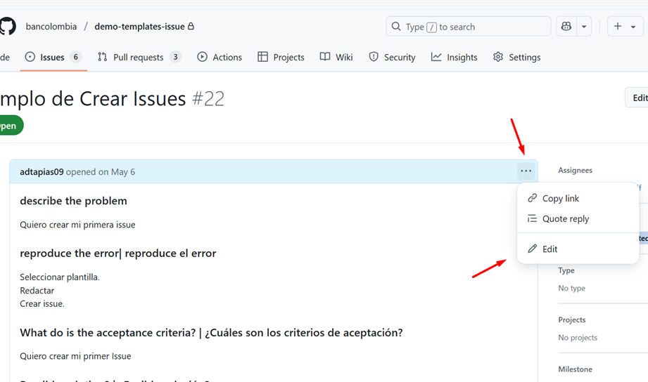
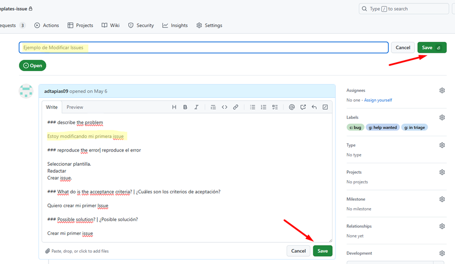
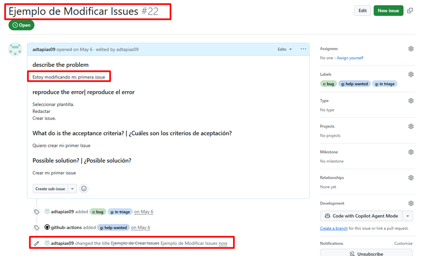
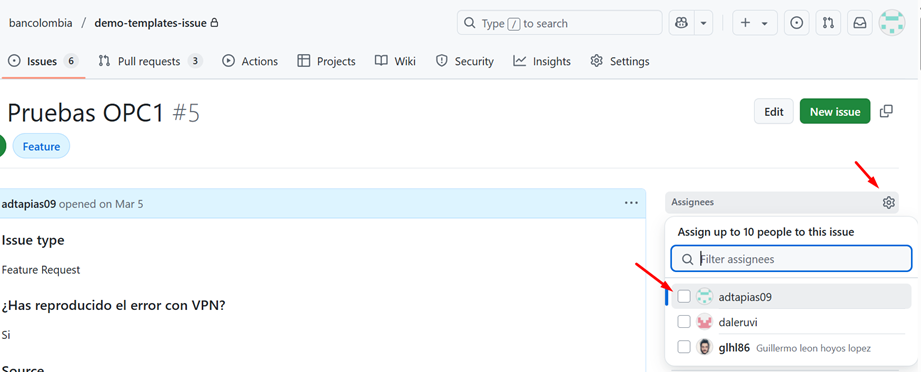
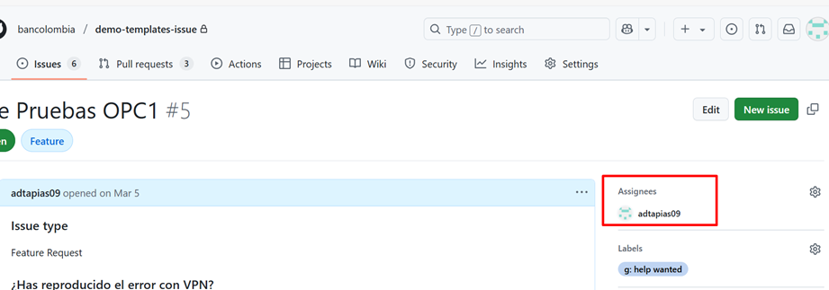

# Gestión de Issues
 
🎏 El módulo Issues o el menú de Issues dentro de un repositorio de GitHub es la herramienta que le permite a los usuarios crear elementos que permiten planificar, rastrear, documentar, analizar, las interacciones con el repositorio. 

Por ejemplo: crear pedidos o solicitudes para nuevas características, reportar errores, describir comentarios, ideas, observaciones y entre otros tipos. 
Otras características y beneficios que permiten es plasmar las necesidades de nuestro proyecto por medio de Issues, es que nos ayudará a resaltar el trabajo en equipo de forma organizada, estructurada por roles, comunicar ideas, detección de errores y oportuna solución. 

## Creación de Issues

1. Para crear un Issue se debe ir a la pantalla principal del home del repositorio ir dar clic en el módulo de Issues. 

 

2. Aquí observamos el listado de Issues existentes. 
Para proceder a crear un nuevo Issues se debe dar clic en la opción “New issue”. 

 

3. Luego se mostrará una serie de plantillas preconfiguradas que facilita al usuario enforcar el contenido del issue que requiere crear, con base a los autorizados por la organización, como por ejemplo: reportar un error, solicitud de mejoras, documentación, hacer preguntas, entre otros. 

  

4. Luego de ver las plantillas de issue recomendadas, se debe dar clic a la plantilla del tipo de issue que se requiere crear. En la posterior pantalla se mostrará un formulario predefinido con los ítems y campos con la información requerida para cumplir con una issue acorde a los estándares y criterios para ser valida. 
 
 

5. Al diligenciar la informaciónde la plantilla predefinida, por ejemplo: Describir el problema, explicar que pasos se deban hacer para visualizar el problema, etc. 
La plantilla seleccionada viene aprovisionada con ciertas etiquetas o labels recomendados para facilitar la interpretación del issue a crear, por ejemplo se visualizara las etiquetas “c: bug” y “g: in triage” teniendo en cuenta que son opcionales y se pueden añadir más etiquetas disponibles desde el módulo de labels o retirarlos si no se consideran acordes a la descripción de la issue. 

Para más información acerca el contenido de etiquetas o labels, ve a la sesión de documentación [Etiquetado de Issues](etiquetas-issues.md)

  

6. Nos redireccionara a nuestro issue creado y nos mostrará como quedo creado con sus textos, etiquetas, estados y demás propiedades que lo componen. Dato importante, luego de crear el issue, como autor del issue, este nos permite editarlo y añadir o quitar elementos según lo necesite. Como corregir textos, añadir o retirar adjuntos, etiquetas, etc; tener en cuenta que los issues cuentan con un historial de ediciones que puede ser visualizado por todo usuario que interactúe con la issue es decir, cada edición que se realice queda registrado fechas, usuarios, y elemento modificado, esto por temas de seguridad y control de información sensible. 

7. Para finalizar podemos dar clic nuevamente en el botón Issue encontrado en el menú principal del proyecto e inmediatamente nos dirigirá al home del modulo de Issues y podremos observar el listado de issues, con el issue creado, para ser gestionado según los procedimientos estipulados dentro de la organización para la ejecución de issues. 

## Modificación de Issues

Luego de crear correctamente un issue, podremos listar y ver el issue creado en la bandeja principal del menú de Issues. 
Si deseamos editar o modificar el issue por alguna razón podremos hacerlo por medio de la opción “Editar Issue” que encontraremos solo si ingresamos a la issuey nos dirigimos a la opción de tres puntos ubicada debajo del título de la issue y este mostrara la opción “Edit”.

Por medio de la opción de modificar issue nos permite actualizar o modificar los atributos del cual está conformado el issue, como el título, el cuerpo (textos, párrafos, estilos, etc), también etiquetas, tiempos, asignaciones, adjuntos, entre otros.
Es muy importante considerar que el issue maneja una bitácora, es decir que todas las ediciones quedan registradas en una especie de historial que el mismo issue almacena y puede ser consultado por los usuarios que interactúen con él, esto como medida de seguridad para administrar y auditar los cambios que se realizan dentro del issue.

## Asignación de Issues

Luego de tener una issue, podemos asignarla a un usuario o más para que este sea el responsable de darle gestión, es decir aplicar el desarrollo que indica la misma en su contenido. 
Para asignar una issue a un usuario, debemos ingresar al issue a asignar, luego vamos al menú de opciones que se visualizan de lado derecho de la issue, donde dice “Assignees” damos clic al icono de tuerca, seguido desplegara una ventana de texto donde escribiremos el nombre del usuario al que deseamos asignar la issue y seguido rápidamente le damos check a su nombre, así quedara asignado dicho usuario y automáticamente le llegara una notificación al usuario como aviso de su asignación.

Adicional en el issue se reflejará dicho usuario en el campo de “Assignees”.

Para quitar la asignación de un usuario sobre una issue, realizamos el mismo procedimiento, y quitamos el check al usuario asignado.

## Cambio de Estados de Issues

Una issue de GitHub permite asociar diferentes estados para dar trazabilidad de su progreso en curso ante los usuarios que le hacen seguimiento. Los estados permitidos en las issue son Open y Closed, que consisten en:

1.	Open (Abierto): El estado por default que tenemos en todas las issue al ser creadas es Open, dicho estado, indica que la issue se encuentra en estado activa para darle gestión y desarrollo.

2.	Closed (Cerrado):  El estado cerrado, es el estado que nos permite asignar la issue, cuando entendamos que la issue fue gestionada y desarrollada hasta su fin, donde en la cual no hace falta mas aportes o aprobaciones, el usuario le asigne Close para notificar la issue como cerrada y finalizada, adicionalmente el estado cerrado, nos permite especificar el tipo de Close que queremos darle a la issue según su gestión, y son las siguientes.

a.	Close as completd (Cerrar como completado): usamos este tipo de Close, cuando nuestra issue este completado satisfactoriamente y no haya más nada que desarrollar y cumplan con las aprobaciones pertinentes.

b.	Cloase as not planned (Cerrar como no planeado): usamos este tipo de Close, cuando queremos dar entender que la issue fue cerrada por motivos que no será abordada dentro de la planificación del equipo o no será tenida en cuenta actualmente dentro de la capacidad del equipo de trabadores.

c.	Close as duplicate (Cerrar como duplicado): usamos este tipo de Close, cuando queremos indicar que la issue fue cerrada por motivo de contenido duplicado es decir, existe otra issue que manifiesta la misma solicitud que la issue cerrada, dando entender que no amerita mantener una segunda issue repetida o que busca la misma finalidad de otra ya existente, por el bien de mantener un orden y buena administración en el tablero de issue, se procede a cerrarla bajo esta especificación.
