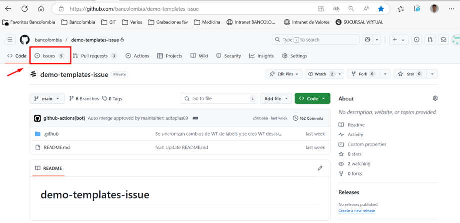
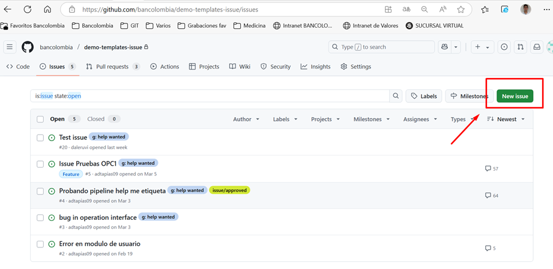
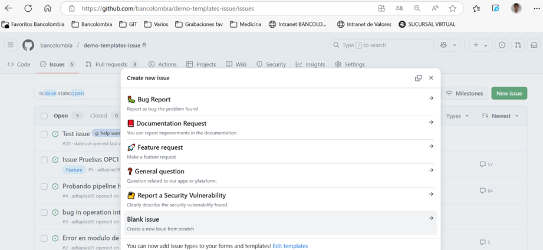
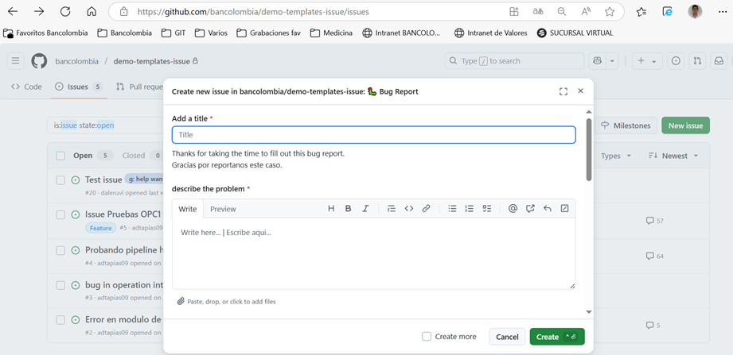
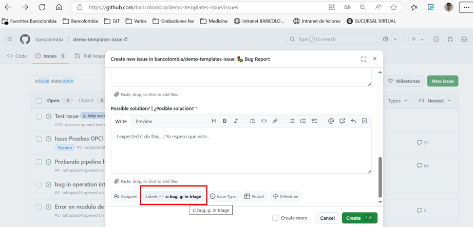
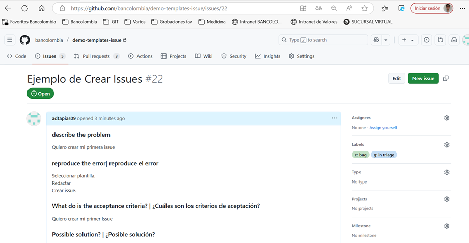
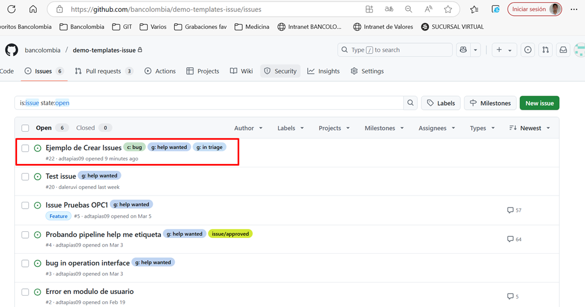

# Gestión de Issues
 
🎏 El módulo Issues o el menú de Issues dentro de un repositorio de GitHub es la herramienta que le permite a los usuarios crear elementos que permiten planificar, rastrear, documentar, analizar, las interacciones con el repositorio. 

Por ejemplo: crear pedidos o solicitudes para nuevas características, reportar errores, describir comentarios, ideas, observaciones y entre otros tipos. 
Otras características y beneficios que permiten es plasmar las necesidades de nuestro proyecto por medio de Issues, es que nos ayudará a resaltar el trabajo en equipo de forma organizada, estructurada por roles, comunicar ideas, detección de errores y oportuna solución. 

## Creación de Issues

1. Para crear un Issue se debe ir a la pantalla principal del home del repositorio ir dar clic en el módulo de Issues. 

 

2. Aquí observamos el listado de Issues existentes. 
Para proceder a crear un nuevo Issues se debe dar clic en la opción “New issue”. 

 

3. Luego se mostrará una serie de plantillas preconfiguradas que facilita al usuario enforcar el contenido del issue que requiere crear, con base a los autorizados por la organización, como por ejemplo: reportar un error, solicitud de mejoras, documentación, hacer preguntas, entre otros. 

  

4. Luego de ver las plantillas de issue recomendadas, se debe dar clic a la plantilla del tipo de issue que se requiere crear. En la posterior pantalla se mostrará un formulario predefinido con los ítems y campos con la información requerida para cumplir con una issue acorde a los estándares y criterios para ser valida. 
 
 

5. Al diligenciar la informaciónde la plantilla predefinida, por ejemplo: Describir el problema, explicar que pasos se deban hacer para visualizar el problema, etc. 
La plantilla seleccionada viene aprovisionada con ciertas etiquetas o labels recomendados para facilitar la interpretación del issue a crear, por ejemplo se visualizara las etiquetas “c: bug” y “g: in triage” teniendo en cuenta que son opcionales y se pueden añadir más etiquetas disponibles desde el módulo de labels o retirarlos si no se consideran acordes a la descripción de la issue. 

Para más información acerca el contenido de etiquetas o labels, is a la sesión de documentación [Etiquetado de Issues](etiquetas-issues.md)

  

6. Nos redireccionara a nuestro issue creado y nos mostrará como quedo creado con sus textos, etiquetas, estados y demás propiedades que lo componen. Dato importante, luego de crear el issue, como autor del issue, este nos permite editarlo y añadir o quitar elementos según lo necesite. Como corregir textos, añadir o retirar adjuntos, etiquetas, etc; tener en cuenta que los issues cuentan con un historial de ediciones que puede ser visualizado por todo usuario que interactúe con la issue es decir, cada edición que se realice queda registrado fechas, usuarios, y elemento modificado, esto por temas de seguridad y control de información sensible. 

7. Para finalizar podemos dar clic nuevamente en el botón Issue encontrado en el menú principal del proyecto e inmediatamente nos dirigirá al home del modulo de Issues y podremos observar el listado de issues, con el issue creado, para ser gestionado según los procedimientos estipulados dentro de la organización para la ejecución de issues. 

## Modificación de Issues

..........

## Asignación de Issues

........

## Cambio de Estados de Issues

........