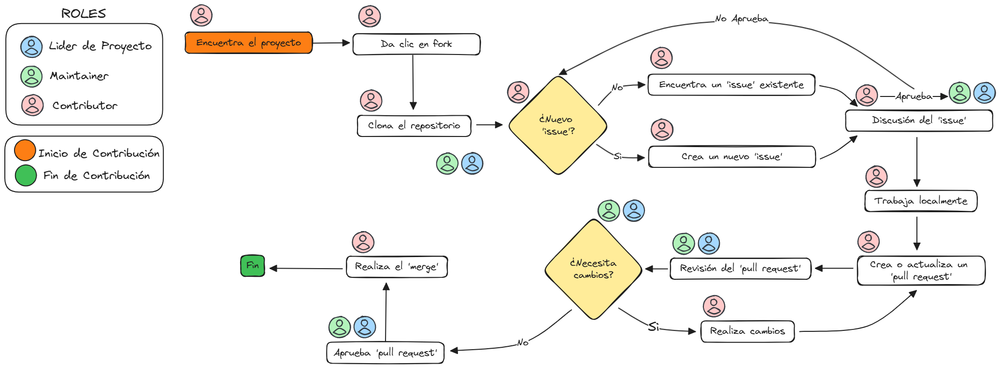

# Guía para Contribuidores

🖐 ¡Bienvenid@s a la comunidad Open Source Bancolombia!
Estamos muy felices por tener tu interés en contribuir a nuestra comunidad.
En esta guía encontraras información necesaria para entender nuestro flujo de contribución.

## ¿Como puedo contribuir? 🤷‍♀️
El repositorio de la comunidad Bancolombia esta abierto al publico con multiples proyectos, en los cuales se pueden contribuir de manera abierta, sin requerir solicitudes de acceso del equipo Bancolombia. 

Podras navegar y buscar proyectos en los cuales tengas interes. 
Luego de encontrar un proyecto, puedes seguir el siguiente flujo de contribución:

1. Haz clic en el botón 'Fork' en la esquina superior derecha del proyecto en el cual estas interesado en contribuir.

2. Clona tu copia del repositorio a tu máquina local.

3. Crea o selecciona un Issue por resolver, esperar por aprobación y asignación.

4. Crea una rama para tu característica o arreglo de bug. Es importante que el nombre de la rama sea descriptivo del cambio que estás realizando.

5. Haz los cambios necesarios en tu rama. Haz commit de tus cambios y sube tu rama a GitHub.

6. Ve a la página de Pull Requests en el repositorio original y crea un nuevo Pull Request desde tu rama.

## Flujo de Contribución ✨

*Haz clic [aquí](img/contributor_flow.png) para ver la imagen en tamaño completo.*

En el proceso de contribución, debes tener presente los lineamientos dados para la comunidad  OpenSource Bancolombia.

## Gestión de issues 💡

Los issues constituyen una pieza clave en la colaboración y organización del desarrollo de software Open Source. Una adecuada gestión de estos permite una comunicación eficiente, organización clara del trabajo pendiente y una participación transparente de la comunidad.

Los `manteiners` y `contribuidores` del proyecto pueden abrir issues para reportar incidencias, sugerir mejoras o hacer preguntas.

Existen etiquetas definidas por la comunidad OpenSource Bancolombia que seran obligatorias. Sin embargo, cada proyecto puede tener etiquetas que le ayuden dentro de su proceso ágil. 

Para más detalle de como  gestionar issues: desde su creación, etiquetado y discusión, hasta su eventual aprobación o rechazo por favor consulta la documentación disponible [Lineamientos de Contribución](category/lineamientos-de-contribución)

## Estructura y uso de branches 🌳

Al realizar contribuciones a nuestros proyectos Open Source, deberás trabajar a partir de una copia (fork) del proyecto en el que estés colaborando. En estos casos, tendrás la responsabilidad de adoptar un flujo de trabajo estructurado; te recomendamos utilizar **Trunk-based**, un modelo que emplea principalmente tres tipos de ramas:

* `trunk o main`: Unica rama principal, donde se integran cambios directamente.
* `release` : Versiones liberadas.
* `feature/*`: Destinadas al desarrollo de nuevas funcionalidades o mejoras específicas.

## Documentación inicial 📋

La documentación base de un proyecto OpenSource es fundamental para asegurar que todos los colaboradores comprendan y puedan contribuir eficazmente al proyecto. Esta documentación debe incluir: Información funcional , Documentación Técnica , Estándares , políticas , guías de contribución. 

Para ampliar la información de esta documentación puedes ingresar a la pagina: 👉[Documentación Base](documentacion-base.md)

## Plantillas de Pull-Request 📋📤
Para la comunidad Bancolombia se determino algunas plantillas que seran automaticamente cargadas en cada uno de los procesos que lo necesiten, de manera que sea mas eficiente el proceso. 

Puede validar las plantillas actuales en 👉[Template PR](Lineamientos-contribucion/template-pr.md)

## Definición de roles y responsabilidades 📜
Cada proyecto opensource tendra personas con roles específicos como `Project Lead`, `Manteiner` o `Contributor`, que son fundamentales para la seguridad, como para la eficiencia en el trabajo en equipo en un proyecto OpenSource. 
 
Para conocer mas sobre como convertiser en Maintainer o Trusted Committer: 
👉 [Como ser](/docs/category/Como-ser).

## Canales de comunicación 📧💻
Puedes comunicarte mediante el correo oficial del equipo de Open Source: 

👉 opensource@bancolombia.com.co

Este canal está disponible para consultas generales, solicitudes de apoyo o para escalar temas que requieran atención específica.