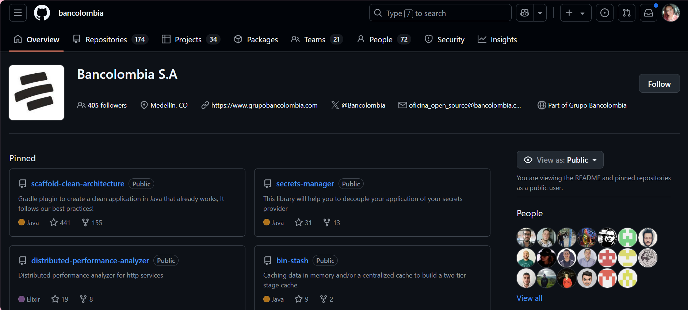
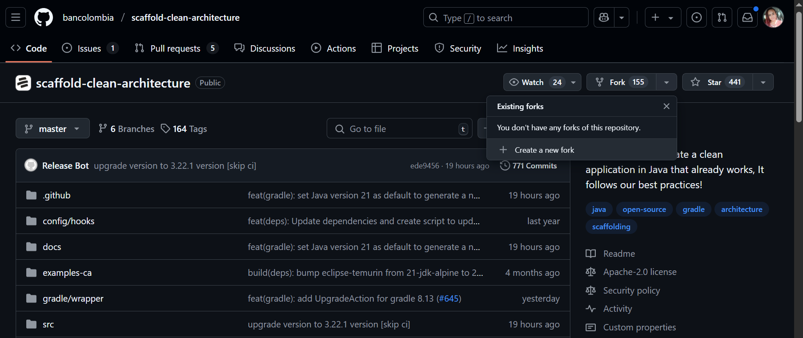
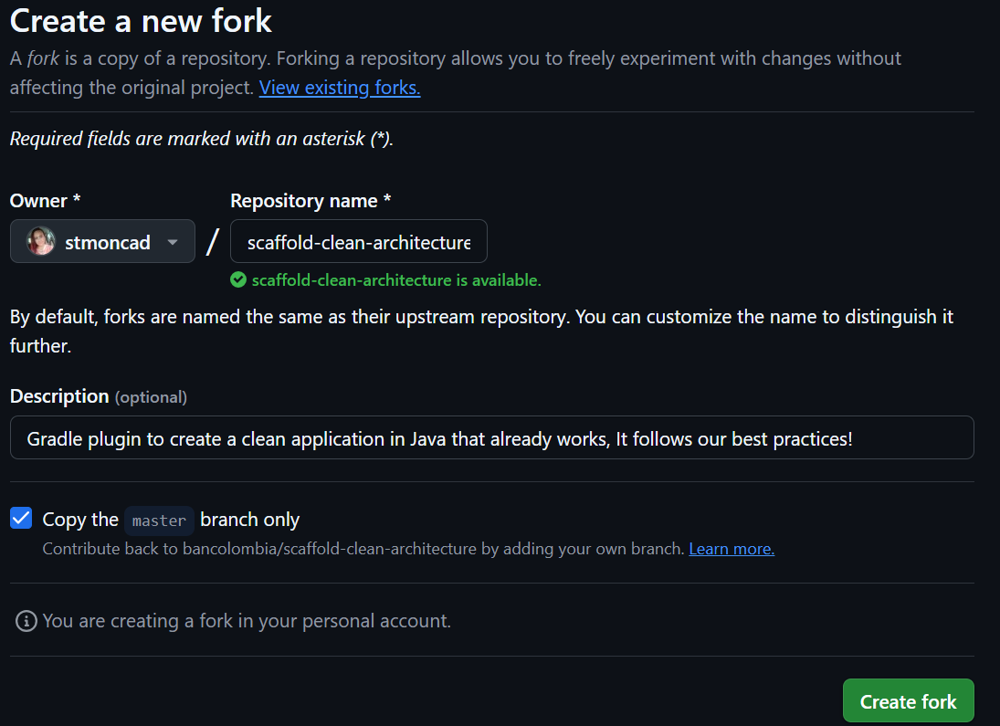
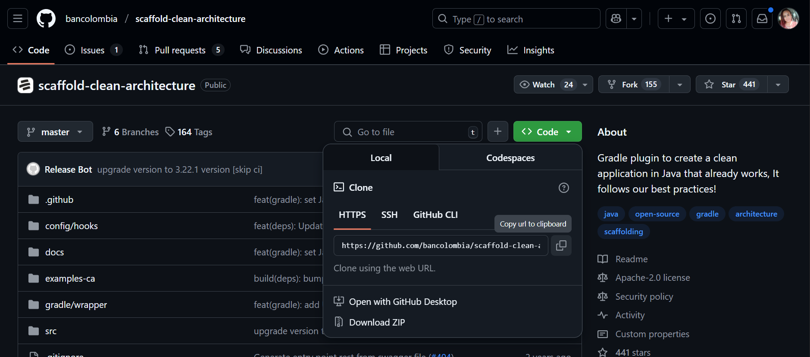

# Guía para Contribuidores

🖐 ¡Bienvenid@s a la comunidad Open Source Bancolombia!
Estamos muy felices por tener tu interés en contribuir a nuestra comunidad.
En esta guía encontraras información necesaria para entender nuestro flujo de contribución.

- [Guía para Contribuidores](#guía-para-contribuidores)
  - [¿Como puedo contribuir? 🤷‍♀️](#como-puedo-contribuir-️)
  - [Flujo de Contribución ✨](#flujo-de-contribución-)
  - [Gestión de issues 💡](#gestión-de-issues-)
  - [Proceso de creación de Issues 📌](#proceso-de-creación-de-issues-)
  - [Etiquetamiento de Issues 🎏](#etiquetamiento-de-issues-)
  - [Estructura y uso de branches 🌳](#estructura-y-uso-de-branches-)
  - [Documentación inicial 📋](#documentación-inicial-)
  - [Plantillas de Pull-Request 📋📤](#plantillas-de-pull-request-)
  - [Conceptos clave 💡](#conceptos-clave-)
  - [Definición de roles y responsabilidades 📜](#definición-de-roles-y-responsabilidades-)
  - [Contribuidor y Permisos 👨‍💻](#contribuidor-y-permisos-)
  - [Canales de comunicación 📧💻](#canales-de-comunicación-)

## ¿Como puedo contribuir? 🤷‍♀️
El repositorio de la comunidad Bancolombia esta abierto al publico con multiples proyectos, en los cuales se pueden contribuir de manera abierta, sin requerir solicitudes de acceso, al equipo Bancolombia. 

1. Podras navegar y buscar proyectos en los cuales tengas interes. Luego de encontrar un proyecto, puedes seguir el siguiente flujo de contribución.

2. Haz clic en el botón 'Fork' en la esquina superior derecha del proyecto en el cual estas interesado en contribuir.

3. Clona tu copia del repositorio a tu máquina local.

4. Crea o selecciona un Issue por resolver, esperar por aprobación y asignación.

5. Crea una rama para tu característica o arreglo de bug. Es importante que el nombre de la rama sea descriptivo del cambio que estás realizando.

6. Haz los cambios necesarios en tu rama. Haz commit de tus cambios y sube tu rama a GitHub.

7. Ve a la página de Pull Requests en el repositorio original y crea un nuevo Pull Request desde tu rama.

## Flujo de Contribución ✨

*Haz clic [aquí](img/contributor_flow.png) para ver la imagen en tamaño completo.*

En el proceso de contribución, debes tener presente los lineamientos dados para la comunidad  OpenSource Bancolombia.

## Gestión de issues 💡

Los issues constituyen una pieza clave en la colaboración y organización del desarrollo de software Open Source. Una adecuada gestión de estos permite una comunicación eficiente, organización clara del trabajo pendiente y una participación transparente de la comunidad.

Esta sección detalla el proceso recomendado para gestionar issues: desde su creación, etiquetado y discusión, hasta su eventual aprobación o rechazo.

## Proceso de creación de Issues 📌
Los `manteiners` y `contribuidores` del proyecto pueden abrir issues para reportar incidencias, sugerir mejoras o hacer preguntas.

Para un proceso claro y detallado sobre cómo crear un issue correctamente, dirígete a la documentación específica:
👉 [Tipos de Issues y Procedimiento de creación](Lineamientos-contribucion/tipos-issue.md)

## Etiquetamiento de Issues 🎏
Existen etiquetas definidas por la comunidad OpenSource Bancolombia que seran obligatorias. Sin embargo, cada proyecto puede tener etiquetas que le ayuden dentro de su proceso Agil. 

Para mayor información es de vital importancia tener presente el Readme del proyecto, y los
[Lineamientos de Contribucion](category/lineamientos-de-contribución) base que tiene la organización.

## Estructura y uso de branches 🌳

Al realizar contribuciones a nuestros proyectos Open Source, deberás trabajar a partir de una copia (fork) del proyecto en el que estés colaborando. En estos casos, tendrás la responsabilidad de adoptar un flujo de trabajo estructurado; te recomendamos utilizar **Gitflow**, un modelo que emplea principalmente tres tipos de ramas:

* `main`: Contiene el código estable y listo para producción.
* `develop`: Integra cambios preparados para el siguiente lanzamiento.
* `feature/*`: Ramas derivadas de `develop`, destinadas al desarrollo de nuevas funcionalidades o mejoras específicas.

## Documentación inicial 📋

La documentación base de un proyecto OpenSource es fundamental para asegurar que todos los colaboradores comprendan y puedan contribuir eficazmente al proyecto. Esta documentación debe incluir: Información funcional , Documentación Técnica , Estándares , políticas , guías de contribución. 

Para ampliar la información de esta documentación puedes ingresar a la pagina: 👉[Documentacion-Base](Documentacion-Base/_category_.json)

## Plantillas de Pull-Request 📋📤
La comunidad Bancolombia determino algunas plantillas que seran automaticamente cargadas en cada uno de los procesos que lo necesiten, de manera que sea mas eficiente y determinista el proceso OpenSource. 

Puede validar las plantillas actuales Lineamientos-contribucion/template-pr.

## Conceptos clave 💡
Conoce los diferentes terminos de nuestro modelo de trabajo Open source dando en la pagina
de [Conceptos clave](concepts-doc.md)

## Definición de roles y responsabilidades 📜
Cada proyecto opensource tendra personas con roles específicos como `Project Lead`, `Manteiner` o `Contributor`, que son fundamentales para la seguridad, como para la eficiencia en el trabajo en equipo en un proyecto OpenSource. 
 
Para conocer mas sobre los roles dirígete a: 
👉 [Roles Open Source](Gobierno/roles-and-responsibilities.md).

## Contribuidor y Permisos 👨‍💻
Como contribuidor de la comunidad Open Source Bancolombia, al interactuar con los repositorios de aplicación podrás:

- Crear un Issue
- Crear una rama
- Crear un pull request
- realizar push/pull a su rama
- Agregar documentación: En docosaurus y a los archivos .MD del proyecto

No podrás (Ya que se asocia a rol de Mainteiner):
- Ejecutar un pipelines 
- Aprobar un Issue
- Hacer Merge
- Eliminar ramas
- Administrar los roles
- Modificar los labels de Issues
- Modificar su rol

Para profundizar más sobre los roles y responsabilidades en OpenSource, revisa la documentación:
👉 [Roles Open Source](Gobierno/roles-and-responsibilities.md)

## Canales de comunicación 📧💻
Puedes comunicarte mediante el correo oficial del equipo de Open Source: 

👉 opensource@bancolombia.com.co

Este canal está disponible para consultas generales, solicitudes de apoyo o para escalar temas que requieran atención específica.